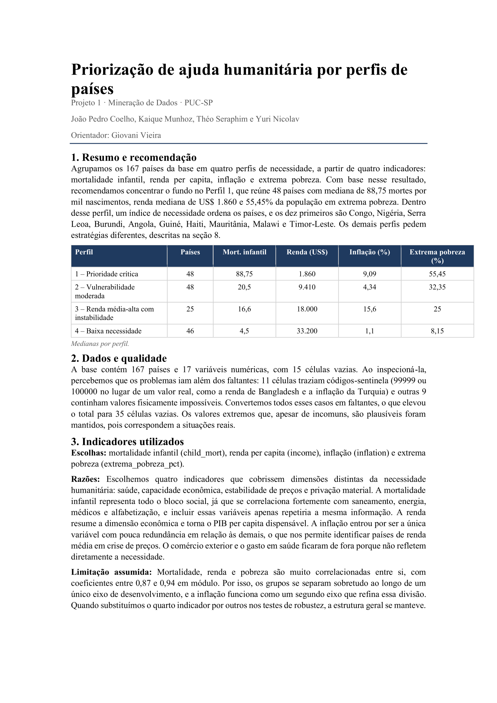

# Priorização de ajuda humanitária por perfis de países

Projeto de **mineração de dados** da disciplina de Mineração de Dados · Ciência de Dados e IA · PUC-SP (set–out 2026).

Agrupamos os **167 países** da base em **quatro perfis de necessidade**, a partir de quatro indicadores: mortalidade infantil, renda per capita, inflação e extrema pobreza. A recomendação é concentrar o fundo no **Perfil 1**. Dentro dele, um índice de necessidade ordena os países.



## Resultado

| Perfil | Países | Mort. infantil | Renda (US$) | Inflação (%) | Extrema pobreza (%) |
|---|---:|---:|---:|---:|---:|
| 1 – Prioridade crítica | 48 | 88,75 | 1.860 | 9,09 | 55,45 |
| 2 – Vulnerabilidade moderada | 48 | 20,5 | 9.410 | 4,34 | 32,35 |
| 3 – Renda média-alta com instabilidade | 25 | 16,6 | 18.000 | 15,6 | 25 |
| 4 – Baixa necessidade | 46 | 4,5 | 33.200 | 1,1 | 8,15 |

*Medianas por perfil.*

**Top 10 do Perfil 1 pelo índice de necessidade:** Congo, Nigéria, Serra Leoa, Burundi, Angola, Guiné, Haiti, Mauritânia, Malawi e Timor-Leste.

## Dados e qualidade

- Base com 167 países e 17 variáveis numéricas.
- 11 células com códigos-sentinela (99999 ou 100000) e 9 com valores impossíveis foram convertidas em faltantes (35 células vazias no total).
- Valores extremos plausíveis foram mantidos, pois correspondem a situações reais.

## Por que esses indicadores

Cobrem dimensões distintas da necessidade: saúde, capacidade econômica, estabilidade de preços e privação material. A mortalidade infantil representa o bloco social, a renda resume o econômico, e a inflação é a variável menos redundante, o que ajuda a identificar países de renda média em crise de preços.

**Limitação:** mortalidade, renda e pobreza são muito correlacionadas (0,87 a 0,94 em módulo). Nos testes de robustez, trocando o quarto indicador, a estrutura dos grupos se manteve.

## Estrutura

```
dados/       base utilizada
notebooks/   análise e agrupamento
docs/        documentação completa (PDF)
imagens/     imagens do README
```

## Ferramentas

Python · Pandas · Análise de dados

## Equipe

João Pedro Coelho, Kaique Munhoz, Théo Seraphim e Yuri Nicolav · Orientador: Giovani Vieira
